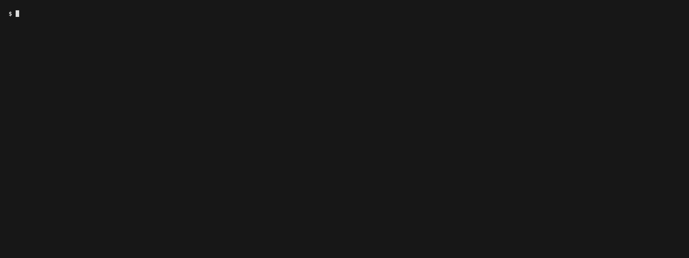

# nm-watch

A live kanban board of your [firstmate](https://github.com/kunchenguid/firstmate) fleet's [no-mistakes](https://github.com/kunchenguid/no-mistakes) runs, in your terminal.



**Use herdr?**
Run `nm-watch herdr-setup` one time, and inside herdr every run opens in a popup over the board.
Without it, runs open full screen.
See [The herdr popup](#the-herdr-popup) for what it does and how to undo it.

## What is this

firstmate runs a crew of coding agents.
Each task ships through a no-mistakes pipeline: intent, rebase, review, test, document, lint, push, pr, ci.
nm-watch shows all of those runs at once, one column per pipeline step and one card per task.
Cards that wait on you (an approval, a fix review, a failure) lead their column in a different colour.

Press Enter on a card to open that run in no-mistakes' own view, where you follow it and make its decisions.
Inside [herdr](https://herdr.dev) the view opens in a popup over the board, and Esc closes the popup while the run keeps going.

nm-watch only reads.
It never changes firstmate state, steers an agent, merges, or tears anything down.

No firstmate fleet yet?
`nm-watch --demo` shows the board with made-up data, so you can try everything below without installing anything else.

## Requirements

| Requirement | Needed for | Check | Get it |
| --- | --- | --- | --- |
| macOS or Linux | Everything | | |
| Node.js 22 or newer | Running nm-watch | `node -v` | [nodejs.org](https://nodejs.org) |
| An interactive terminal | The board is a full-screen TUI; it does not run with piped input or output | | |
| A firstmate home | Watching a real fleet (not needed for `--demo`) | `ls ~/firstmate/bin/fm-bearings-snapshot.sh` | `git clone https://github.com/kunchenguid/firstmate ~/firstmate`, then start your agent there as its README describes |
| `jq` | firstmate's snapshot script, which nm-watch calls (not needed for `--demo`) | `jq --version` | `brew install jq`, or your package manager |
| `no-mistakes` | The pipeline columns and Enter on a run (not needed for `--demo`) | `no-mistakes --version` | `curl -fsSL https://raw.githubusercontent.com/kunchenguid/no-mistakes/main/docs/install.sh \| sh` |
| herdr 0.7.4 or newer, optional | The popup for Enter and Esc, after `nm-watch herdr-setup` once | `herdr --version` | [herdr.dev](https://herdr.dev) |

The `gh` CLI is not an nm-watch requirement.
nm-watch never calls it, and the board works with `gh` missing.
firstmate and no-mistakes use an authenticated `gh` (`gh auth login`) to open and watch pull requests, so you need it to ship work, not to watch it.

nm-watch was tested with firstmate at commit `3c8396a` (October 2026), no-mistakes v1.84.0, and herdr 0.9.3.
It reads `bin/fm-bearings-snapshot.sh`, `bin/fm-crew-state.sh`, and `state/<task>.meta` and `.status` in the firstmate home, and runs `no-mistakes axi status` for each run.

## Install

The npm package is named nm-board because nm-watch was too close to an existing package name, but the command you run is `nm-watch`.

```sh
npm i -g nm-board
nm-watch --help
```

If `nm-watch --help` says `command not found`, npm's global bin directory is not on your `PATH`.
Find it with `npm prefix -g` and add its `bin` folder to `PATH`.
If the install fails with `EACCES`, point npm at a folder you own, as the [npm docs](https://docs.npmjs.com/resolving-eacces-permissions-errors-when-installing-packages-globally) describe.

To install from a clone instead:

```sh
git clone https://github.com/davidrydberg/nm-watch
cd nm-watch
npm install
npm run build
npm i -g .
```

## Quick start

Run nm-watch in its own terminal window or herdr pane, next to the fleet.
Inside herdr, run `nm-watch herdr-setup` one time so runs open in a popup (step 3).

1. Try the demo.
   It needs nothing but Node.

   ```sh
   nm-watch --demo
   ```

   Move with the arrow keys and press Enter on a card to open a stand-in run view.
   Esc or `q` returns to the board, and `q` on the board quits.

2. Watch your real fleet.
   Point nm-watch at your firstmate home, the folder you cloned firstmate into:

   ```sh
   nm-watch --home ~/firstmate
   ```

   To stop typing the path, set `FM_HOME` once, for example in `~/.zshrc` or `~/.bashrc`:

   ```sh
   export FM_HOME=~/firstmate
   nm-watch
   ```

   `--home` wins over `FM_HOME`.
   The first read of a large fleet can take 10 to 20 seconds, and the header says `reading fleet...` until it lands.
   After that the board refreshes by itself.

3. Open runs in a herdr popup.
   This is optional, and only for people who run nm-watch inside herdr.
   Link nm-watch's herdr plugin one time:

   ```sh
   nm-watch herdr-setup
   ```

   That runs `herdr plugin link` on the plugin folder inside the installed package.
   It changes no herdr config, keybindings, or hooks; herdr only records the link in its plugin registry.

   To check it worked, press Enter on a card inside herdr.
   A popup opens over the board, and Esc closes it while the run keeps going.

   If it is not set up, the run opens full screen instead.
   `q` brings you back to the board, and the footer then says `no herdr popup (herdr: plugin not found); nm-watch herdr-setup links it`.
   Outside herdr, Enter always opens the run full screen.

   To undo it, run `herdr plugin unlink nm-watch`.

## Keys

| Key | Action |
| --- | --- |
| `←` `→` or `h` `l` | Move to the next column with cards |
| `↑` `↓` or `k` `j` | Select a card in the column |
| Enter | Open the selected run in no-mistakes: in a herdr popup inside herdr, else full screen |
| Esc, in a run's popup | Close the popup and return to the board; the run keeps going |
| `q`, in a full-screen run | Leave no-mistakes' view and return to the board |
| `/` | Filter by id, project, state, status as the card shows it, or text; Enter keeps it, Esc clears it |
| Esc | Clear the filter |
| `r` | Refresh everything now |
| `q` or Ctrl+C | Quit |

## Troubleshooting

Each message below is what nm-watch prints, and what to do about it.

| What you see | Why | Fix |
| --- | --- | --- |
| `nm-watch: no firstmate home: pass --home <dir> or set FM_HOME` | Neither `--home` nor `FM_HOME` is set. | `nm-watch --home ~/firstmate`, or `export FM_HOME=~/firstmate`. To just look around, use `nm-watch --demo`. |
| `nm-watch: <dir> does not look like a firstmate home (no bin/fm-bearings-snapshot.sh)` | The folder is missing, or is not a firstmate checkout. | Point `--home` at the folder that holds firstmate's `bin/` and `state/`. `ls <dir>/bin/fm-bearings-snapshot.sh` must work. |
| Header says `fleet error: ... jq not found`, and the board stays empty | firstmate's snapshot script needs `jq`. | Install it (`brew install jq`). Press `r`. |
| Header says `fleet error:` with another message | firstmate's snapshot script failed. | Run `<home>/bin/fm-bearings-snapshot.sh --json --all-in-flight` yourself to see the full error. The board keeps the last good data and retries. |
| Every card sits in **no run** as `unreadable`, and the bottom line says `no-mistakes is not installed or not on PATH` | `no-mistakes` is not installed, or not on the `PATH` of the terminal that runs nm-watch. | Install no-mistakes and check `no-mistakes --version` in the same terminal. Press `r`. |
| Cards stay in **no run** with `no run` | The task's worktree has no no-mistakes run yet. | Nothing to fix. The card moves as soon as the run starts. |
| Header shows `reading fleet...` for a long time | A large fleet can take 10 to 20 seconds on the first read. Each read is cut off after 60 seconds. | Wait, or press `r`. |
| Enter inside herdr opens the run full screen, and after `q` the footer says `no herdr popup (herdr: plugin not found); nm-watch herdr-setup links it` | You are inside herdr and nm-watch's plugin is not linked. | Run `nm-watch herdr-setup` once, then press Enter on the card again. |
| `nm-watch: herdr is not installed or not on PATH` from `herdr-setup` | herdr is not installed. | Install herdr, or skip the popup: Enter still works full screen. |
| `herdr plugin link failed` | An older nm-watch plugin is already linked from another path. | `herdr plugin unlink nm-watch`, then `nm-watch herdr-setup` again. |
| The popup stops working after you reinstall nm-watch or switch Node versions | herdr still points at the old install folder. | `herdr plugin unlink nm-watch`, then `nm-watch herdr-setup`. |
| The popup shows only `no-mistakes exited with status N; if it printed nothing above, it may not be on the PATH herdr runs plugins with` | `no-mistakes` is not on the `PATH` herdr starts plugins with, for example when herdr was launched from a desktop launcher. | Start herdr from a terminal where `no-mistakes --version` works. |
| `herdr plugin unlink nm-watch` says `server_not_running` | `unlink` needs a running herdr, while `link` does not. | Start herdr, then run `unlink` again. |
| `ERROR Raw mode is not supported on the current process.stdin` | nm-watch is not attached to an interactive terminal, for example when piped or run from a script. | Run it directly in a terminal. |
| `npm warn EBADENGINE ... required: { node: '>=22' }` | Your Node.js is older than 22. | Upgrade Node.js. |

## Uninstall

```sh
herdr plugin unlink nm-watch   # only if you ran nm-watch herdr-setup; herdr must be running
npm rm -g nm-board
```

nm-watch keeps one small cache folder, which you can delete:

```sh
rm -rf ~/Library/Caches/nm-watch                  # macOS
rm -rf "${XDG_CACHE_HOME:-$HOME/.cache}/nm-watch" # Linux
```

## The board

The board has one column per no-mistakes pipeline step, in pipeline order: intent, rebase, review, test, document, lint, push, pr, and ci.
A run that reports other steps adds them in its own order.
A leading **no run** column holds tasks whose worktree has no run yet, and tasks whose run could not be read.
A final **finished** column holds runs that reached their outcome, such as passed or cancelled.

Each card is one task with a no-mistakes run, in the column of the step its run stands at:

- the step parked at a gate, awaiting approval or fix review;
- else the step that is running or fixing;
- else, for a failed run, the step that failed;
- else the first step that has not completed.

A card shows the task, the step status as no-mistakes names it, the project, and how long the run has been at that step.
That time is what no-mistakes reports for a running step or a parked gate; other cards show no time.
Cards waiting on a person (awaiting approval, fix review, or failed) lead their column and are drawn in the decision colour, and ⚑ marks a task with an open captain decision.

An empty column shrinks to its name so the busy ones get the room.
When the columns still do not fit, the board scrolls sideways to follow the selection, and the bottom line counts the columns off either side.
The bottom line also names the selected task, its run, and any error.

The header shows how old the fleet snapshot is.
A failed read keeps the last good data on screen, says so, and flags it stale once it is well past its interval.

## Opening a run

Enter on a card runs `no-mistakes attach --run <run id>` in the task's worktree, or in its firstmate home once the worktree is gone.
Everything you see and decide in there is no-mistakes' own screen and behaviour.

Inside herdr, the view opens in a popup over the board, and the board keeps refreshing underneath.
Esc closes the popup and returns to the board without stopping, aborting, or otherwise changing the run.
The footer says so: `enter open run (esc closes it)`.

Esc works by leaving no-mistakes' view the way no-mistakes itself offers.
The popup runs no-mistakes on a terminal of its own and turns a lone Esc into Ctrl+C, which no-mistakes treats as detach in every screen, including its editors; the pipeline keeps running in its daemon.
`q` detaches too, as in no-mistakes.
Inside the popup, Esc therefore no longer closes no-mistakes' own help, diff, or editors: `?` and `d` toggle help and diff, and Esc leaves an editor along with the view.
Aborting a run is still only no-mistakes' own `x`, pressed twice.

Outside herdr, nm-watch hands its whole terminal to no-mistakes until you leave its view with `q`, then redraws the board and re-reads that task.
The same happens inside herdr when the plugin is not linked, and the footer then says why.
If no-mistakes is missing or the attach fails, the board comes back with the reason in its footer.

## The herdr popup

herdr opens popups only for plugin panes, so nm-watch ships a minimal herdr plugin in `herdr-plugin/`.
It declares one popup pane that runs nm-watch's run view, and nothing else: no actions, startup or event hooks, or keybindings.
Link it once:

```sh
nm-watch herdr-setup
```

That runs `herdr plugin link` on the plugin folder inside the installed package.
It changes no herdr config, keybindings, or hooks; herdr only records the link in its plugin registry, for every herdr session of your user.
To check it worked, press Enter on a card inside herdr: a popup opens over the board, Esc closes it, and the run keeps going.
Undo it with `herdr plugin unlink nm-watch`.
If nm-watch moves, such as after a reinstall under another Node version, unlink and run `nm-watch herdr-setup` again.
If you linked the plugin back when this tool was called fleetwatch, run `herdr plugin unlink fleetwatch`, then `nm-watch herdr-setup`.
The popup needs herdr 0.7.4 or newer.

## Where the data comes from

nm-watch only reads.
It never writes to firstmate state, steers an agent, merges, or tears anything down.
Every command runs in the background under a timeout, so a slow command never blocks the view.
The one exception is opening a run outside a herdr popup, which hands the terminal to no-mistakes until you leave it.

| Source | Command or file | Cadence |
| --- | --- | --- |
| Fleet snapshot | `bin/fm-bearings-snapshot.sh --json --all-in-flight` | Every 15s |
| Current task state | `bin/fm-crew-state.sh <task>` | Every 5s |
| Meta and status log | `state/<task>.meta`, `.status` | Every 5s |
| Pipeline | `no-mistakes axi status --run <id>`, else `no-mistakes axi status` in the worktree | Every 5s |
| Run view | `no-mistakes attach --run <id>` in the worktree, in a herdr popup or full screen | On Enter |

Done and unknown agents are re-read every 30s instead of every 5s.
Absent agents, such as remote secondmate homes, are not read at all.
At most four local commands run at once.

The snapshot's parent-side cache of remote secondmate summaries goes to the user cache directory (`~/Library/Caches/nm-watch` on macOS, `$XDG_CACHE_HOME/nm-watch` or `~/.cache/nm-watch` elsewhere) instead of the home's `state/`.
The pipeline read uses the run id crew-state names; without one, the worktree's latest run counts only when it is on the task's own branch.

nm-watch does not read remote secondmate homes over ssh, so their children's runs are not on the board.
A local secondmate's children are read from that secondmate's own home.

## Development

```sh
npm install
npm run typecheck # type-check the sources and tests
npm test          # type-check, then run the tests with the Node test runner
npm run build     # compile src/ to dist/, the files the package publishes
node dist/cli.js  # run the local build
```

Tests cover every parser, the board's column placement and navigation, the model's update logic, the attach command, and the app's wiring of keys, background reads, and the run view.
They also cover the choice between the herdr popup and the full-screen view, the popup request herdr receives, Esc turning into a detach, and the demo fleet.
They use synthetic fixtures under `test/fixtures`, written in the exact shapes of the real command output and state files, and need no live firstmate home, herdr, or no-mistakes daemon.

To re-record the demo GIF after a visible change, install [vhs](https://github.com/charmbracelet/vhs) and run `npm run build && vhs assets/demo.tape`.

CI runs the type-check, the tests, and the build on Node 22 and 24.

## Releasing

`main` only accepts pull requests, so bump the version on a branch and publish from the merged `main`.
`prepublishOnly` runs the type-check and the tests, and `prepack` runs the build, so a broken version cannot be published.

```sh
npm version patch --no-git-tag-version  # or minor/major; open and merge a PR with the bump
git checkout main && git pull
npm publish --dry-run                   # check the tarball contents
npm publish                             # publishes publicly to npm
git tag v$(node -p "require('./package.json').version")
git push origin --tags
```

## License

MIT, see [LICENSE](LICENSE).
